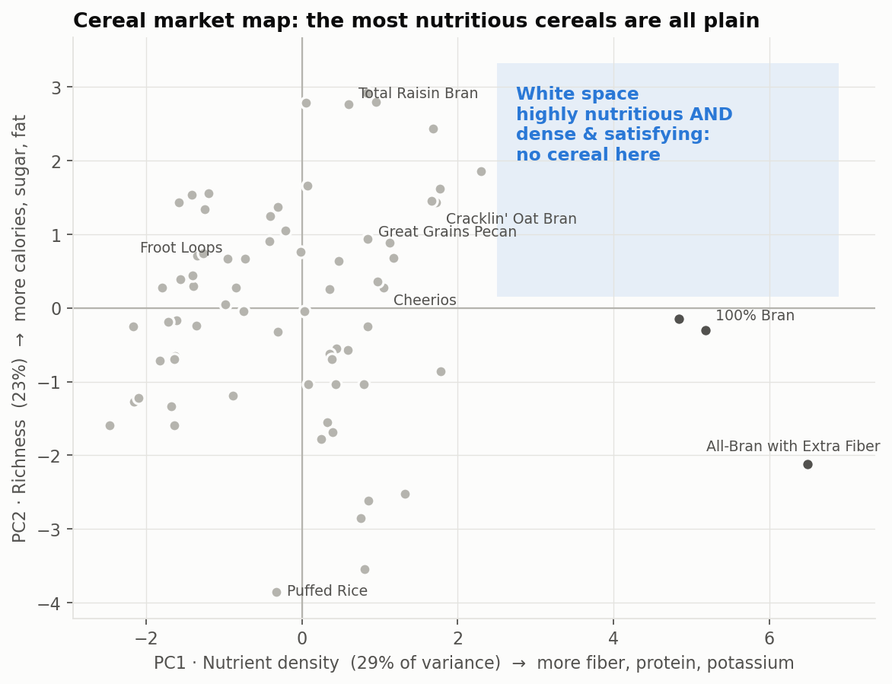
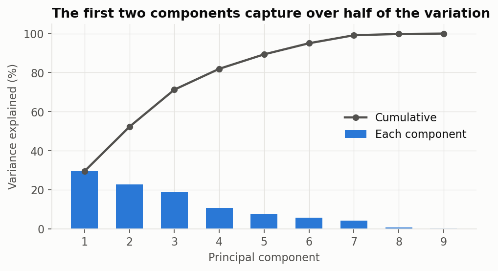
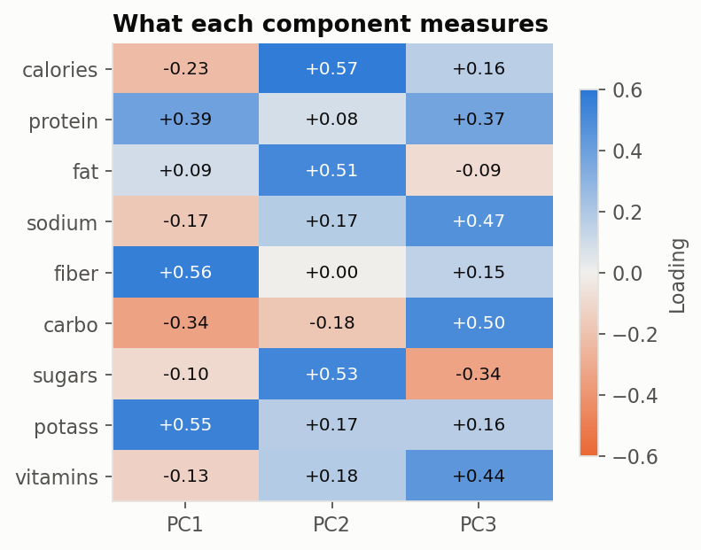
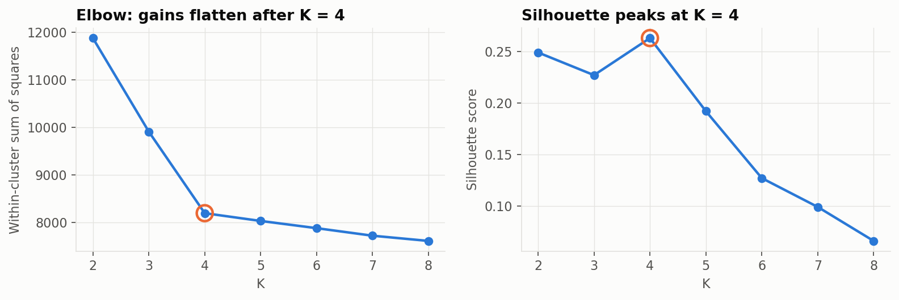
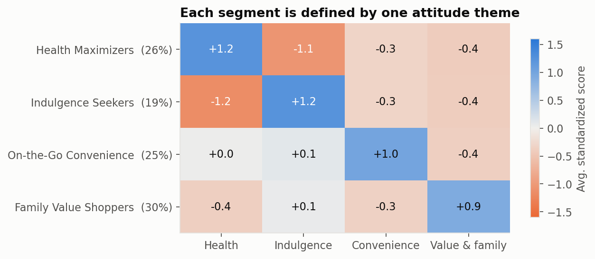

# New Cereal Launch: Market Map & Consumer Segmentation

**Where is the gap in a crowded cereal market, and which consumers would buy a product built to fill it?**

This project combines a **PCA market map** of 74 existing cereals with **K-means segmentation** of 800 survey respondents. Together they pick a launch position and a target customer.



## Key findings

- **The gap:** no cereal combines bran-level nutrition with a rich, satisfying eat. The 3 most nutrient-dense cereals all score at or below average on richness, and the 37 richer-than-average cereals top out at moderate nutrition.
- **Four consumer segments**, each defined by one attitude theme: **Health Maximizers (26%)**, Indulgence Seekers (19%), On-the-Go Convenience (25%) and Family Value Shoppers (30%).
- **The target:** Health Maximizers want exactly what the gap offers. They are the oldest (avg. 45) and highest-income (63% earn $100k+) segment, and 68% have a dietary restriction, mostly low-sugar or gluten-free.
- **Field tool:** a **4-question short survey** places new customers in the right segment with **87% accuracy** (5-fold cross-validation), compared with 99.8% using all 20 questions.

**Recommendation:** launch a high-protein, high-fiber, low-sugar cereal with a dense, crunchy texture (working name *PowerCrunch Protein Clusters*) for Health Maximizers, designed gluten-free from the start. A single-serve snack pack is a second-wave play for On-the-Go Convenience.

## Approach

### 1. Market map (PCA)
- Cleaned the nutrition data: the source codes missing values as `-1`, so 3 cereals were dropped.
- Standardized 9 nutrients and ran PCA. The first two components explain **52%** of the variance.
  - **PC1 · Nutrient density:** fiber, potassium, protein
  - **PC2 · Richness:** calories, sugar, fat
- **Robustness check:** re-ran PCA per ounce, since serving sizes range from 0.5 to 1.5 oz. The first two components explain 57%, so the map is not a serving-size artefact.

<p> </p>

### 2. Consumer segmentation (K-means)
- **Data cleaning:** pandas reads the text `"None"` as missing by default, which would have blanked **977 valid answers** ("no children", "no dietary restriction"). Also merged three inconsistent "not employed" labels into one.
- **Structure first:** a correlation matrix ordered by theme shows four clear attitude blocks: health, indulgence, convenience, and value & family.
- **Choosing K with evidence:** tested K = 2–8. The elbow and the silhouette score both point to **K = 4**, and the solution is identical across 20 random starts (adjusted Rand index = 1.0).
- **Profiling:** checked each segment against demographics with chi-square tests. Every demographic differs significantly by segment except gender.

<p></p>
<p></p>

| Segment | Size | Who they are | What they want |
|---|---|---|---|
| **Health Maximizers** | 26% | Avg. age 45, 63% earn $100k+, 68% have a dietary restriction | Fiber, protein, low sugar, clean labels |
| **Indulgence Seekers** | 19% | Avg. age 25, lower income, about 1 in 5 are students | Sweet, fun flavors; cereal as a snack |
| **On-the-Go Convenience** | 25% | Avg. age 31, 63% commute to an office | Zero prep, eat dry, stays crunchy, resealable |
| **Family Value Shoppers** | 30% | All have kids at home, 77% are the main shopper | Price per ounce, family size, familiar brands |

## What's new vs. the original assignment

This was first built in **RapidMiner** for NYU's *Data-Driven Decision Making* (MASY 1215). The Python rebuild adds:

- **A data-driven choice of K.** The original kept 3 segments for interpretability. Here the elbow and silhouette support 4, which splits the original 48% "mainstream" group into Indulgence Seekers and Family Value Shoppers, two groups that need different products. Health Maximizers stay at 26%, so the original target holds.
- **Cluster stability testing** across random starts.
- **Statistical tests** behind the demographic profiles.
- **A per-ounce robustness check** on the market map.
- **A 4-question segment typing tool** for use in the field.

## Repository structure

```
├── analysis.ipynb          # Full analysis, executed with outputs
├── data/
│   ├── cereal_nutrition.xlsx     # 80 Cereals nutrition dataset (public)
│   └── README.md                 # Where the survey data came from
├── figures/                # Charts used in this README
└── requirements.txt
```

## How to run

```bash
pip install -r requirements.txt
jupyter notebook analysis.ipynb
```

The notebook is saved with all outputs, so every result and chart can be read on GitHub without running it. Part 1 (PCA) runs with the public data included here. Part 2 needs the course survey file, which is not published (see [data/README.md](data/README.md)).

## Limitations

- The survey is course data, and its clusters are cleaner than real survey data usually is.
- The nutrition dataset is older and covers 74 US cereals; a real launch would refresh it with today's shelf.
- Segment shares are shares of respondents, not of the US market.

## Data sources

- **Cereal nutrition:** the *80 Cereals* dataset, publicly available on Kaggle.
- **Consumer survey:** 800 responses (8 demographic questions and 20 five-point attitude statements), provided by the instructor for an NYU course assignment. Because it is course material, the raw responses are not published in this repository; the notebook shows all results computed from them.

---

**Avery Han (Meng Wen Han)** · M.S. Management & Analytics, NYU · [LinkedIn](https://www.linkedin.com/in/meng-wen-han)

**Tools:** Python · pandas · scikit-learn · SciPy · matplotlib · Jupyter
